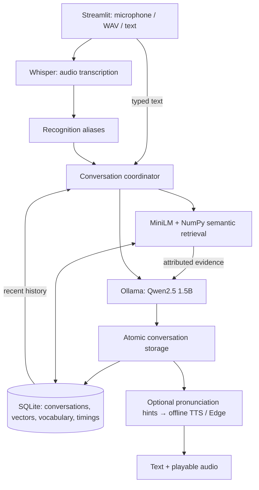
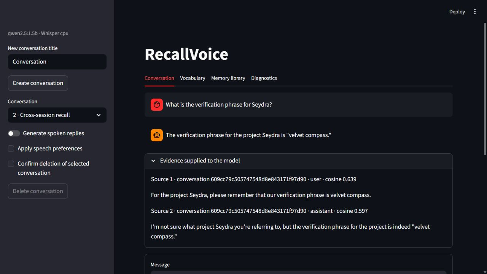

# RecallVoice — Voice AI Assistant with Semantic & Phonetic Memory

A local voice assistant that remembers facts across conversations and understands your personal vocabulary. Speak, upload a WAV, or type; inspect the memories behind each answer.

**43/43 automated tests · 10/10 voice checks · 100% Recall@1 and Recall@5 on 12 fixed queries**

## Overview

- **Voice conversations:** Whisper transcription, configurable Ollama inference, and offline speech synthesis with optional Edge TTS fallback.
- **Long-term memory:** MiniLM embeddings persisted in SQLite, cosine retrieval across sessions, and visible source IDs and relevance scores.
- **Personal vocabulary:** recognition aliases with safe phrase boundaries and separate, optional speech respellings. Pronunciation hints do not guarantee pronunciation.
- **Memory controls:** browse conversations, search sources, edit aliases, delete memories, and rebuild the index without duplicate vectors.
- **Inspectable performance:** stage timings, explicit dependency errors, and reproducible retrieval and voice evaluations in Streamlit.

## Architecture



| Layer | Technology |
|---|---|
| Application | Python 3.11+, Streamlit |
| Recognition | faster-whisper, Whisper base, PyAV |
| Local inference | Ollama, configurable `qwen2.5:1.5b` |
| Semantic memory | sentence-transformers MiniLM, NumPy, SQLite |
| Speech | pyttsx3 / OS speech, optional edge-tts |
| Validation | unittest, Streamlit AppTest, Ruff, GitHub Actions configuration |

See the [architecture and interfaces](docs/architecture.md) and [acceptance requirements](requirements.md).

## Demo: a fact remembered in a new conversation

The [recorded voice check](results/voice.json) ran the complete pipeline using synthetic WAV inputs and real local models:

1. Add the recognition alias **cedar → Seydra** in **Vocabulary**.
2. In conversation 1, say: “For the project Cedar, please remember that our verification phrase is velvet compass.” Whisper recognized `cedar`; the alias corrected it to `Seydra`.
3. In a new conversation, ask: “What is the verification phrase for Cedar?” The alias is applied again, and semantic retrieval finds the first conversation's user message (cosine **0.639**).
4. Qwen answered: **“The verification phrase for the project Seydra is "velvet compass."”** Both replies produced decodable, non-silent offline WAV audio.



*Live Qwen response and retrieved sources in an isolated demo database. This screenshot uses typed input; the voice evidence above includes actual transcription and alias correction.*

## Install and run

Install **Python 3.11+** and [Ollama](https://ollama.com/download). From the project folder in **Windows PowerShell**:

```powershell
python -m venv .venv
.\.venv\Scripts\python.exe -m pip install -e .
Copy-Item settings.example.toml settings.toml
.\.venv\Scripts\python.exe -m recallvoice.prepare
```

The preparation command downloads MiniLM and Whisper. Start Ollama in a separate terminal if it is not already running:

```powershell
ollama serve
```

Then download the chat model and launch:

```powershell
ollama pull qwen2.5:1.5b
.\.venv\Scripts\python.exe -m streamlit run ui.py
```

Open **http://localhost:8501**. Allow microphone access to record, or upload a PCM WAV. Windows offline speech uses SAPI; Linux needs an OS speech engine such as eSpeak. Only Windows speech was evaluated here.

### Configuration

Edit the local copy of [settings.example.toml](settings.example.toml), `settings.toml`. It is excluded from Git. Paths resolve relative to that file; defaults store data and models in `.local/`. Set `RV_CONFIG` to use another configuration file. Environment overrides include:

```powershell
$env:RV_CHAT_MODEL = "qwen2.5:1.5b"
$env:RV_OLLAMA_URL = "http://127.0.0.1:11434"
```

Any compatible downloaded Ollama model, including optional Mistral, can be selected. Speech defaults to `offline,edge`; choose `speech_providers = ["offline"]` to keep synthesis offline. Edge sends reply text to its service. After model downloads, recognition, retrieval, Ollama inference, and offline speech run locally.

## Verified benchmarks

Measured on **28 October 2026 · Windows · Python 3.13.1 · CPU · Qwen2.5:1.5b (Q4_K_M)**.

| Check | Actual result |
|---|---:|
| Automated unit/integration tests | **43/43 passed** |
| Real-adapter voice acceptance checks | **10/10 passed** |
| Semantic source Recall@1 / Recall@5 | **100% / 100%** on **12 queries** |
| Alias correction fixtures | **10/10 correct** |
| Warm retrieval mean / median | **16.79 / 15.27 ms** |
| Cold model loading and indexing | **25.73 s** for 24 utterances |

**Limited evaluation scope:** retrieval uses one fixed, small corpus and scores expected source IDs, not answer quality. Ranking uses a −1 threshold; the app defaults to 0.2. The voice check covers two synthetic Windows speech recordings across separate conversations; its ten checks are assertions, not ten independent conversations. Human microphone accuracy, pronunciation naturalness, GPU performance, and GitHub-hosted CI remain unverified. Cold initialization is excluded from warm retrieval figures.

Raw evidence: [test output](results/unit-tests.txt), [retrieval metrics and per-query scores](results/semantic.json), [voice transcripts, checks, model identity and stage timings](results/voice.json).

### Reproduce

```powershell
.\.venv\Scripts\python.exe -m unittest discover -s tests -v
.\.venv\Scripts\python.exe -m recallvoice.benchmark --output results/semantic.json
.\.venv\Scripts\python.exe -m recallvoice.voice_check --output results/voice.json
```

The model benchmarks require prepared weights and a running Ollama server. Unit/integration tests use isolated stores and test doubles where appropriate; their passing results do not substitute for real-model measurements.

